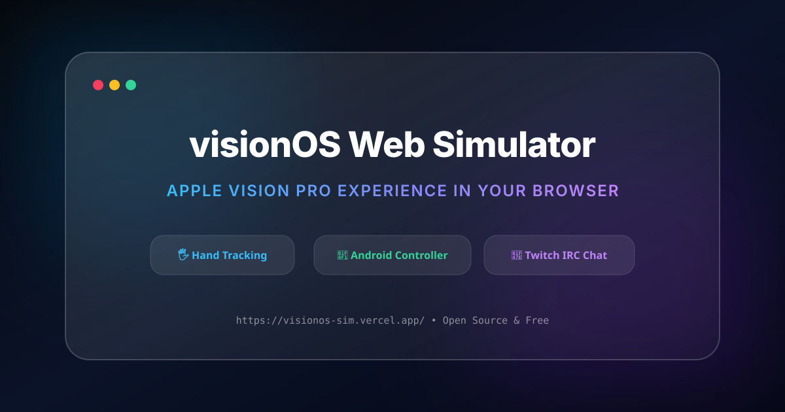

# 🥽 visionOS Web Simulator & Spatial Ecosystem

<p align="center">
  
</p>

<p align="center">
  <a href="https://github.com/anyelo888ra-ux/visionos-sim"></a>
  <a href="https://visionos-sim.vercel.app/"></a>
  <a href="https://github.com/anyelo888ra-ux/visionos-sim/releases"></a>
  <a href="LICENSE"></a>
</p>

**visionOS Web Simulator** es una experiencia web interactiva de alto rendimiento que recrea el entorno espacial, la estética de cristal (*glassmorphism*) y el sistema de interacción táctil/gestual de los **Apple Vision Pro**. 

Permite ser controlado por webcam (MediaPipe Hands), mouse, control remoto nativo desde Android (*visionOS Controller APK*), teclado virtual en pantalla o mediante comandos de chat en vivo de Twitch.

---

## 🔥 Características Principales

- 🖐️ **Hand Tracking 60 FPS:** Navegación espacial por webcam detectando puntos de articulación manuales mediante **MediaPipe Hands**.
- ⌨️ **Teclado Virtual Espacial:** Escribe en tiempo real usando únicamente los dedos y gestos de pinza (*pinch*), sin teclado físico.
- 🖼️ **Estudio Inmersivo & Chroma Key (Green Screen):** Entorno espacial en 3D que recorta el fondo de tu cámara y te sitúa dentro de una habitación virtual interactiva.
- 🔗 **Invitaciones de Control Remoto:** Generador de enlaces de sesión compartida tipo `/invitation/controller/<code>` y `/invitation/view/<code>`.
- 📱 **Controlador Android Nativo (APK):** App en Kotlin/Jetpack Compose con trackpad multitáctil, corona digital interactiva, biometría y comunicación por IP local o USB.
- 🎮 **Chat Use visionOS (Twitch Control):** Conexión IRC directa para que tus espectadores de Twitch jueguen y controlen las ventanas con comandos (`!youtube`, `!snake`, `!notes`, `!up`, `!down`, etc.).
- 🐍 **Snake Arcade Pro:** Minijuego espacial integrado controlable por teclado, gestos o comandos del chat.
- ✨ **Glassmorphism Avanzado:** Ventanas flotantes arrastrables con desenfoque de fondo en tiempo real (*backdrop-filter*).

---

## ⚡ Inicio Rápido

1. Visita la versión en vivo en [visionos-sim.vercel.app](https://visionos-sim.vercel.app/) o descarga este repositorio.
2. Abre el teclado flotante o la app de Invitaciones para controlar la interfaz sin hardware adicional.
3. Descarga e instala la app de Android desde las [GitHub Releases](https://github.com/anyelo888ra-ux/visionos-sim/releases) si deseas usar tu smartphone como Trackpad Espacial.

---

## 📂 Estructura del Proyecto

```text
visionos-sim/
├── index.html        # Simulador web completo (UI, MediaPipe, Twitch IRC, Teclado Virtual y Chroma Studio)
├── favicon.svg       # Icono espacial del ecosistema
├── banner.svg        # Banner gráfico promocional para Twitter, Discord y OpenGraph
├── LICENSE           # Licencia MIT de código abierto
└── README.md         # Documentación oficial del proyecto
```

---

## 🤝 Contribuir

¡Las contribuciones son bienvenidas! Para agregar nuevas apps o gestos:

1. Haz un **Fork** del repositorio.
2. Crea una rama para tu mejora (`git checkout -b feature/nueva-app`).
3. Guarda tus cambios (`git commit -m 'Añadida nueva app espacial'`).
4. Sube la rama (`git push origin feature/nueva-app`).
5. Abre un **Pull Request**.

---

## 📄 Licencia

Distribución bajo Licencia **MIT**. Consulta el archivo `LICENSE` para más detalles.
